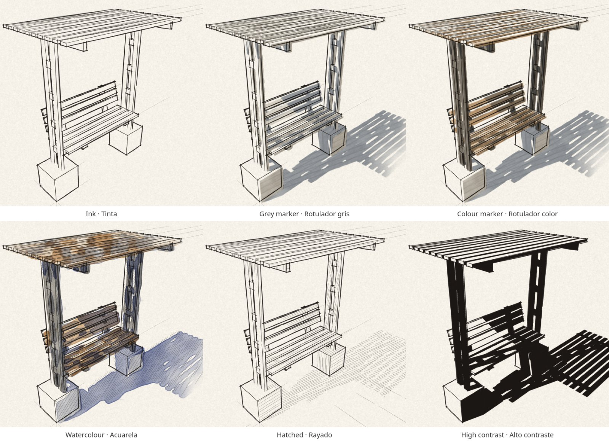
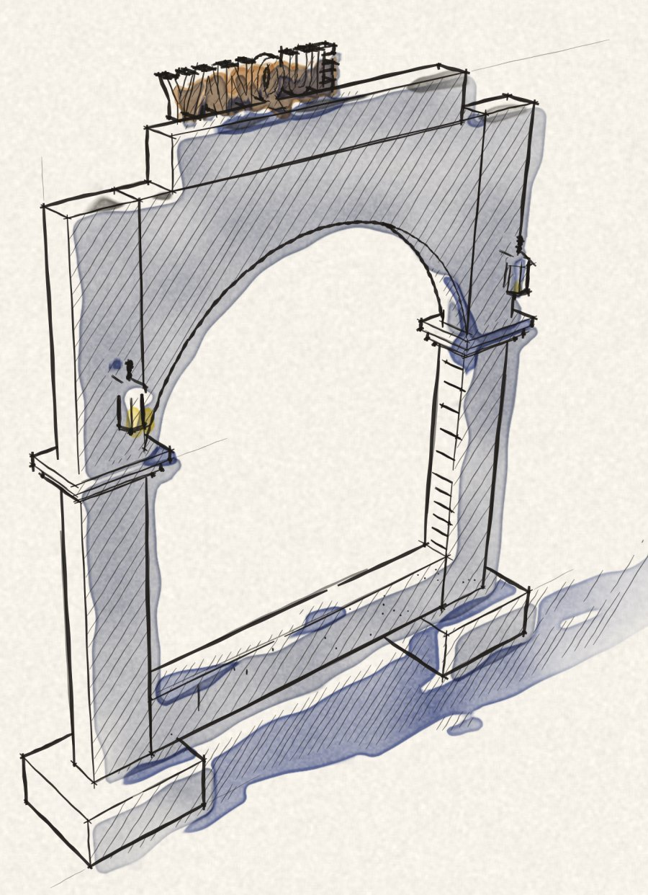
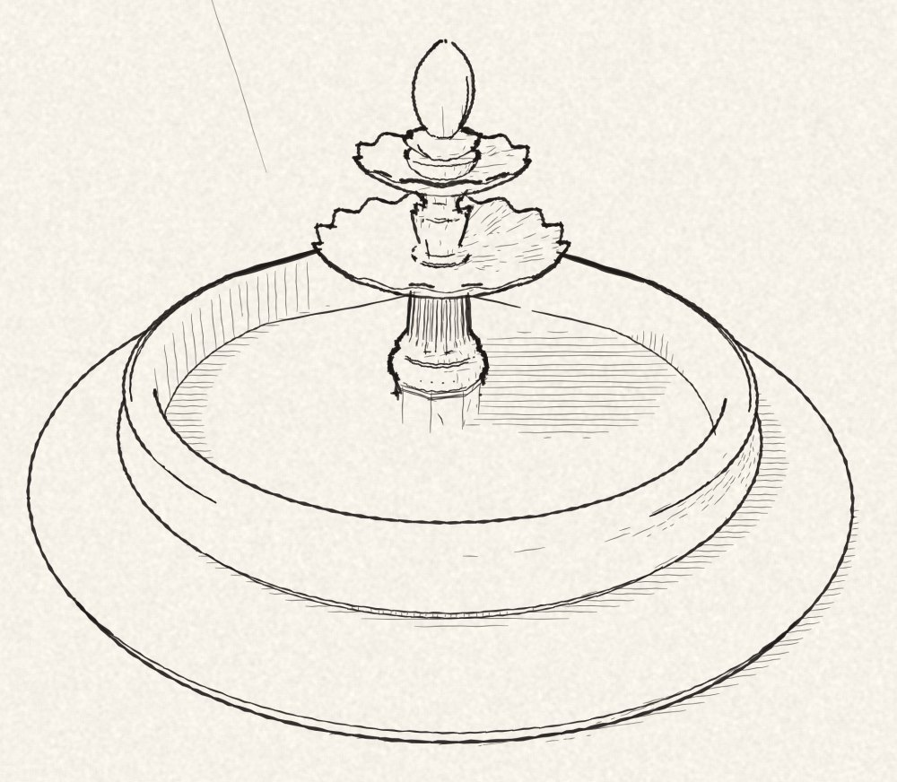
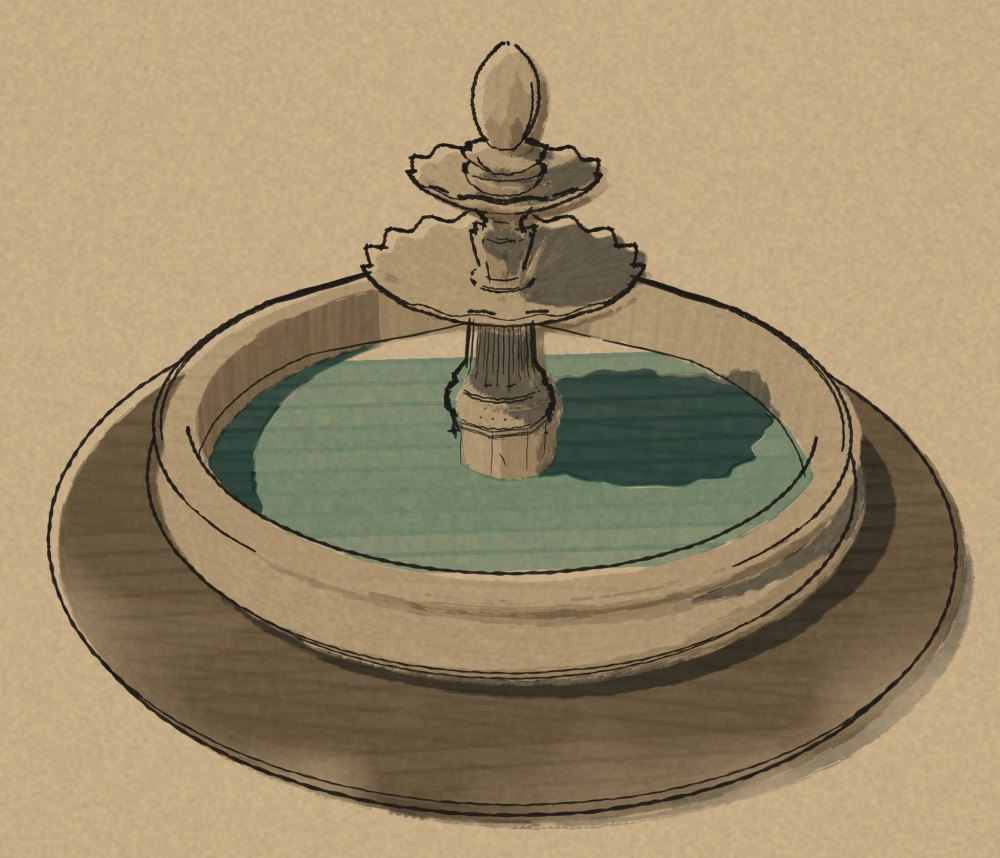
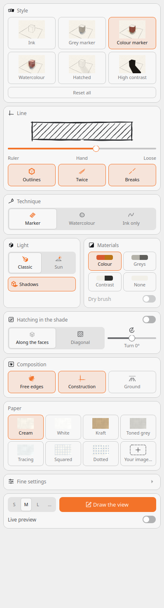
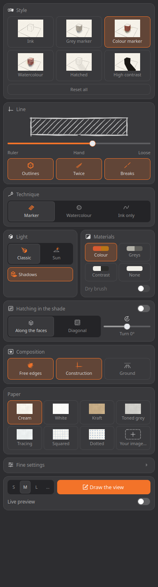

# Croquis for IngeTrazo

**[English](#english) · [Español](#español) · [Português](#português)**

An extension for [IngeTrazo](https://github.com/ingelibre/ingetrazo) that
draws the current view of your model as an architect's **freehand sketch on
paper**: ink lines that run past the corners and waver with the hand, grey
or colour marker, watercolour, hatching or high-contrast ink, on the paper
you choose.



---

## English

### What it does

- **The line of a hand:** strokes that overshoot at real corners, bow and
  waver, swell in the middle and thin at the ends, sometimes drawn twice,
  with the outlines heavier than the edges inside. From *Ruler* to *Loose*.
- **Six ready-made styles:** Ink, Grey marker, Colour marker, Watercolour,
  Hatched and High contrast. Change anything and it becomes *Custom*.
- **Light and shade:** each face lit by a classic sketcher's light or by
  the sun of IngeTrazo's Shadows panel, with the cast shadows, also on the
  ground under the model.
- **The materials:** in colour (the nearest of a box of twenty markers),
  in greys, in high contrast, or not at all.
- **Composition:** the colour thins out toward the edges of the sheet,
  some lines run on as construction lines, and loose strokes can go on
  the ground.
- **Paper:** cream, white, kraft, toned grey, tracing, squared, dotted, or
  an image of your own.
- **Size and export:** S, M, L, a width of your own, or a page (A5, A4, A3
  at 150 or 300 dpi). Save as **PNG**, **SVG in layers** (paper, colour,
  and the ink as editable vector paths) or **PDF**.
- **Live preview:** the sketch over IngeTrazo's view, redrawn a moment
  after you stop moving.
- **Large models:** a model of 700 000 faces draws in about half a minute
  with IngeTrazo's Rust engine on (a little over a minute without it), and
  fine detail is simplified as a hand would, so it reads instead of
  turning into a black mass.

<p>



</p>

### Install

**From IngeTrazo** (recommended): **Extensions ▸ Manage extensions…**, look
for *Croquis*, press **Install** and restart IngeTrazo. A **Croquis** tab
appears in the side tray. Updates are offered there too.

**By hand:** download `croquis-<version>.zip` from
[Releases](https://github.com/vicc3d/croquis-ingetrazo/releases), open
**Extensions ▸ Open extensions folder**, unzip it there (you get a
`croquis` folder) and restart IngeTrazo.

A copy installed by hand and one installed from the catalog cannot live
side by side: delete the `croquis` folder before installing from the
catalog.

Needs IngeTrazo 0.5.8 or later; works with 0.5.9's Rust engine on or off.

### Use

Frame the view, open the **Croquis** tab, pick a style and press **Draw
the view**. The drawing opens in a window of its own, to copy or save.

<p>


</p>

The panel is a set of small boxes, one decision each: **Style**, **Line**
(the hand, outlines, lines drawn twice, breaks), **Technique** (marker,
watercolour, ink only), **Light** and **Materials**, **Hatching in the
shade**, **Composition**, **Paper**, and the **Fine settings**, folded.
It follows IngeTrazo's light or dark theme and its accent colour, and
keeps your settings between sessions. Perspective, two-point and parallel
views all work.

### Croquis for Blender

The same drawing exists for Blender, for any scene:
[Croquis for Blender](https://github.com/vicc3d/croquis-blender).

### How it works

- **Which lines:** the model's triangles go into a depth buffer at the
  drawing's resolution, and every edge is walked pixel by pixel; where
  nothing stands in front of it, it shows. Soft edges show only where the
  surface turns away from the eye. Pieces that continue each other in a
  straight line are joined, so a wall's edge is one stroke. (IngeTrazo's own
  hidden-line pass is exact, but takes minutes on a large model; a sketch
  does not need exact lines.)
- **Outlines:** a line with the background, or a surface well behind it, on
  one side is where a shape ends, and is drawn heavier.
- **The marker:** the same depth buffer says which face shows at every
  pixel; its normal against the light gives the value. The strokes run up
  a wall (the world's vertical, as drawn) or across a floor along its
  flatter axis, and are multiplied onto the paper, as a marker's ink is.
- **Cast shadows:** a second depth buffer, seen from the light (a shadow
  map); every pixel of the view is taken back to its point on the model,
  which is in shadow when something nearer the light covers it there.
- **The colours:** from IngeTrazo's own index of the view's triangles,
  the face each one belongs to and its paint (or its group's; a texture by
  its average colour), sent to the nearest marker.
- **Watercolour:** each wash's edge wanders with a smooth noise, near its
  fill only; its density with a broader one and the paper's grain; the rim
  where it ends is darker.
- **Hatching:** parallel lines across the whole view, cut to the shaded
  areas and drawn with the hand's strokes, lighter than the edges.
- **The hand:** each line overshoots at real corners only (never where it
  passes behind something), bows more the longer it is, wavers, swells and
  thins. Everything random is seeded by the line itself, so the same view
  always gives the same drawing.
### Tests

```bash
python -m pytest tests/test_strokes.py
INGETRAZO_SRC=/path/to/ingetrazo QT_QPA_PLATFORM=offscreen \
    /path/to/ingetrazo/venv/bin/python -m pytest tests
```

The second run checks the lines against IngeTrazo's exact hidden-line
drawing, in perspective, two-point and parallel.

---

## Español

Una extensión para [IngeTrazo](https://github.com/ingelibre/ingetrazo) que
dibuja la vista de tu modelo como un **croquis a mano alzada sobre papel**,
como lo haría un arquitecto: líneas de tinta que sobresalen en las esquinas
y tiemblan con la mano, rotulador gris o de color, acuarela, rayado o tinta
de alto contraste, en el papel que elijas.

### Qué hace

- **La línea de una mano:** trazos que sobresalen en las esquinas de
  verdad, se curvan y tiemblan, más gruesos al centro y finos en las
  puntas, a veces repasados, con las siluetas más marcadas. Desde *Regla*
  hasta *Suelta*.
- **Seis estilos listos:** Tinta, Rotulador gris, Rotulador color,
  Acuarela, Rayado y Alto contraste. Si cambias algo, pasa a
  *Personalizado*.
- **Luz y sombra:** cada cara iluminada por una luz clásica de croquis o
  por el sol del panel Sombras de IngeTrazo, con las sombras arrojadas,
  también sobre el suelo bajo el modelo.
- **Los materiales:** en color (el rotulador más cercano de una caja de
  veinte), en grises, en alto contraste o sin ellos.
- **Composición:** el color se desvanece hacia los bordes de la hoja,
  algunas líneas siguen como líneas de construcción y puede haber trazos
  sueltos en el suelo.
- **Papel:** crema, blanco, kraft, gris, calco, cuadriculado, punteado o
  una imagen tuya.
- **Tamaño y exportación:** S, M, L, un ancho a medida o una hoja (A5, A4,
  A3 a 150 o 300 ppp). Se guarda como **PNG**, **SVG por capas** (papel,
  color y la tinta como trazos vectoriales editables) o **PDF**.
- **Vista previa en vivo:** el croquis sobre la vista de IngeTrazo, que se
  vuelve a dibujar un momento después de que dejas de moverte.
- **Modelos grandes:** un modelo de 700 000 caras se dibuja en medio
  minuto con el motor Rust de IngeTrazo encendido (algo más de un minuto
  sin él), y el detalle fino se simplifica como lo haría una mano, para
  que se lea y no quede como una mancha negra.

### Instalar

**Desde IngeTrazo** (recomendado): **Extensiones ▸ Gestionar
extensiones…**, busca *Croquis*, pulsa **Instalar** y reinicia IngeTrazo.
Aparece la pestaña **Croquis** en la bandeja lateral. Las actualizaciones
llegan por ahí.

**A mano:** descarga `croquis-<versión>.zip` desde
[Releases](https://github.com/vicc3d/croquis-ingetrazo/releases), abre
**Extensiones ▸ Abrir carpeta de extensiones**, descomprímelo ahí (queda
una carpeta `croquis`) y reinicia IngeTrazo.

Una copia instalada a mano y otra del catálogo no pueden convivir: borra
la carpeta `croquis` antes de instalar desde el catálogo.

Necesita IngeTrazo 0.5.8 o posterior; funciona con el motor Rust de la
0.5.9 encendido o apagado.

### Uso

Encuadra la vista, abre la pestaña **Croquis**, elige un estilo y pulsa
**Dibujar la vista**. El dibujo se abre en su propia ventana, para
copiarlo o guardarlo. El panel sigue el tema claro u oscuro de IngeTrazo y
su color de acento, y recuerda tus ajustes entre sesiones.


### Croquis para Blender

El mismo dibujo existe para Blender, con cualquier escena:
[Croquis para Blender](https://github.com/vicc3d/croquis-blender).

---

## Português

Uma extensão para o [IngeTrazo](https://github.com/ingelibre/ingetrazo) que
desenha a vista do seu modelo como um **croqui à mão livre sobre papel**,
como faria um arquiteto: linhas de nanquim que passam dos cantos e tremem
com a mão, marcador cinza ou colorido, aquarela, hachura ou nanquim de alto
contraste, no papel que você escolher.

### O que faz

- **A linha de uma mão:** traços que passam dos cantos de verdade, se
  curvam e tremem, mais grossos no meio e finos nas pontas, às vezes
  repassados, com as silhuetas mais marcadas. De *Régua* a *Solta*.
- **Seis estilos prontos:** Tinta, Marcador cinza, Marcador colorido,
  Aquarela, Hachurado e Alto contraste. Se você mudar algo, passa a
  *Personalizado*.
- **Luz e sombra:** cada face iluminada por uma luz clássica de croqui ou
  pelo sol do painel Sombras do IngeTrazo, com as sombras projetadas,
  também no chão sob o modelo.
- **Os materiais:** em cor (o marcador mais próximo de uma caixa de
  vinte), em cinzas, em alto contraste ou sem eles.
- **Composição:** a cor some em direção às bordas da folha, algumas
  linhas continuam como linhas de construção e pode haver traços soltos
  no chão.
- **Papel:** creme, branco, kraft, cinza, vegetal, quadriculado,
  pontilhado ou uma imagem sua.
- **Tamanho e exportação:** S, M, L, uma largura sob medida ou uma folha
  (A5, A4, A3 a 150 ou 300 dpi). Salva em **PNG**, **SVG em camadas**
  (papel, cor e o nanquim como traços vetoriais editáveis) ou **PDF**.
- **Vista ao vivo:** o croqui sobre a vista do IngeTrazo, redesenhado um
  momento depois que você para de se mover.
- **Modelos grandes:** um modelo de 700 000 faces é desenhado em meio
  minuto com o motor Rust do IngeTrazo ligado (pouco mais de um minuto sem
  ele), e o detalhe fino é simplificado como faria uma mão, para que se
  leia e não vire uma mancha preta.

### Instalar

**Pelo IngeTrazo** (recomendado): **Extensões ▸ Gerenciar extensões…**,
procure *Croquis*, clique em **Instalar** e reinicie o IngeTrazo. Aparece a
aba **Croquis** na bandeja lateral. As atualizações chegam por ali.

**À mão:** baixe `croquis-<versão>.zip` em
[Releases](https://github.com/vicc3d/croquis-ingetrazo/releases), abra
**Extensões ▸ Abrir pasta de extensões**, descompacte ali (fica uma pasta
`croquis`) e reinicie o IngeTrazo.

Uma cópia instalada à mão e outra do catálogo não podem conviver: apague
a pasta `croquis` antes de instalar pelo catálogo.

Precisa do IngeTrazo 0.5.8 ou posterior; funciona com o motor Rust da
0.5.9 ligado ou desligado.

### Uso

Enquadre a vista, abra a aba **Croquis**, escolha um estilo e clique em
**Desenhar a vista**. O desenho abre na sua própria janela, para copiar ou
salvar. O painel segue o tema claro ou escuro do IngeTrazo e sua cor de
destaque, e lembra seus ajustes entre sessões.


### Croquis para Blender

O mesmo desenho existe para o Blender, com qualquer cena:
[Croquis para Blender](https://github.com/vicc3d/croquis-blender).

---

## Support · Apoyo · Apoio

Croquis is free. If it is useful to you, you can buy me a coffee on
[Ko-fi](https://ko-fi.com/vicc3d). · Croquis es gratis; si te sirve, puedes
invitarme un café en [Ko-fi](https://ko-fi.com/vicc3d). · O Croquis é
gratuito; se for útil, você pode me pagar um café no
[Ko-fi](https://ko-fi.com/vicc3d).

## Credits · Créditos

**Concept, UX/UI & Design:** [Victor Crespo](https://3dvic.com)

The images show the Yanque plaza models that come with IngeTrazo, by
Marco Sumari Tellez,
[CC BY 4.0](https://creativecommons.org/licenses/by/4.0/). · Las imágenes
muestran los modelos de la plaza de Yanque que trae IngeTrazo, de Marco
Sumari Tellez, [CC BY 4.0](https://creativecommons.org/licenses/by/4.0/deed.es).
· As imagens mostram os modelos da praça de Yanque que vêm com o
IngeTrazo, de Marco Sumari Tellez,
[CC BY 4.0](https://creativecommons.org/licenses/by/4.0/deed.pt_BR).

Independent extension, not affiliated with IngeTrazo's maintainers.
IngeTrazo is by Marco Sumari Tellez and contributors. · Extensión
independiente, sin relación con quienes mantienen IngeTrazo. · Extensão
independente, sem relação com quem mantém o IngeTrazo.

License · Licencia · Licença: GPL-3.0-or-later.
